# Hearth AI - Architecture Documentation

## Overview

The Hearth AI is a **local cross-platform web-based** AI chat application with advanced capabilities including Retrieval-Augmented Generation (RAG) and web search integration. The application runs entirely locally using llama.cpp for LLM inference and provides a modern web interface accessed via browser.

### Core Features
- 💬 **Direct Chat** - Conversation with local LLM models
- 📄 **RAG (Retrieval-Augmented Generation)** - Document-based Q&A with source citations
- 🌐 **Web Search** - Real-time web search integration via DuckDuckGo
- 🔄 **Streaming Responses** - Real-time token streaming for improved UX
- 💾 **Conversation Management** - Save, load, and manage chat history
- 📁 **Document Processing** - Support for PDF, TXT, MD, and DOCX files

## High-Level Architecture

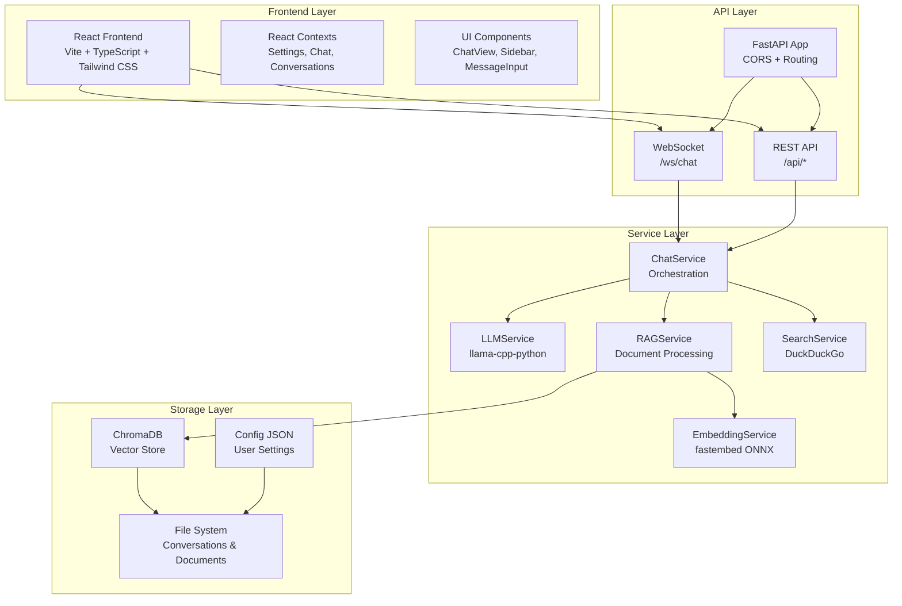

## Detailed System Architecture

### 1. Frontend Architecture

The frontend is built with React 19, TypeScript, and Vite, providing a modern and responsive user interface.

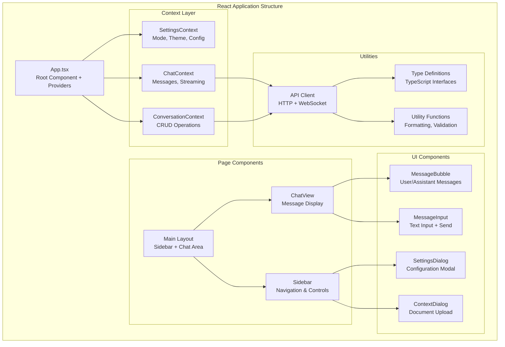

#### Key Frontend Components

- **App.tsx**: Root component that provides React contexts and manages global state
- **ChatContext**: Manages chat messages, streaming state, and WebSocket connections
- **ConversationContext**: Handles conversation CRUD operations and persistence
- **SettingsContext**: Manages application settings, themes, and configuration
- **Sidebar**: Navigation, mode selection, conversation list, and document management
- **ChatView**: Main chat interface with message display and auto-scrolling
- **MessageBubble**: Individual message rendering with source citations
- **MessageInput**: Text input with send functionality and keyboard shortcuts

### 2. Backend API Architecture

The backend uses FastAPI to provide both REST endpoints and WebSocket connections for real-time streaming.

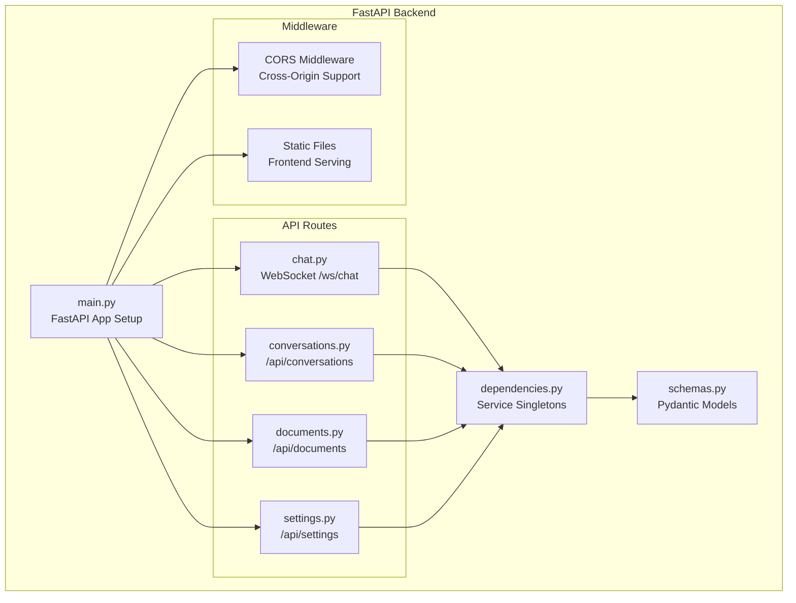

#### API Endpoints

| Endpoint | Method | Purpose | Response |
|----------|--------|---------|----------|
| `/ws/chat` | WebSocket | Real-time streaming chat | Token stream |
| `/api/conversations` | GET | List all conversations | Array of conversations |
| `/api/conversations` | POST | Create new conversation | Created conversation |
| `/api/conversations/{id}` | GET | Load specific conversation | Conversation details |
| `/api/conversations/{id}` | DELETE | Delete conversation | Success status |
| `/api/documents` | GET | List uploaded documents | Array of documents |
| `/api/documents` | POST | Upload document | Upload status |
| `/api/documents/{id}` | DELETE | Delete document | Success status |
| `/api/settings` | GET | Get current settings | Configuration object |
| `/api/settings` | PUT | Update settings | Updated configuration |
| `/api/model/status` | GET | Model loading status | Status object |

#### WebSocket Protocol

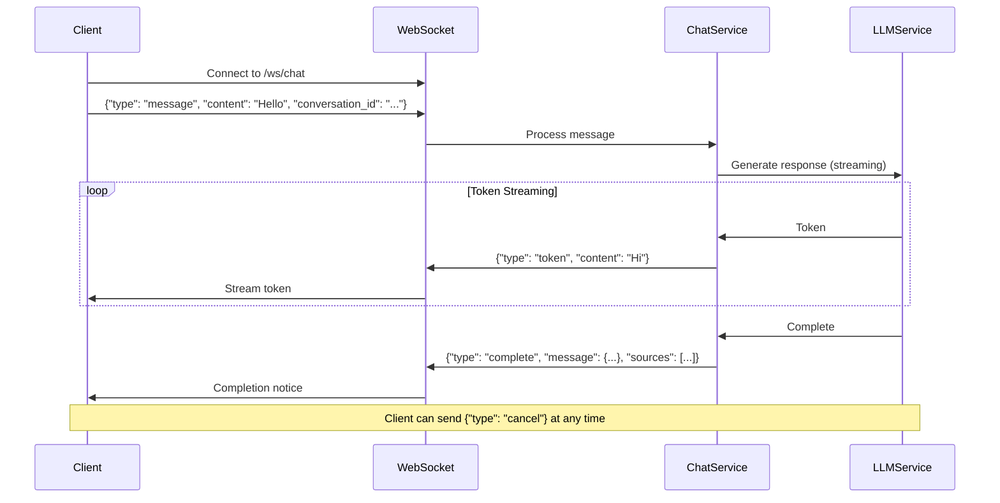

### 3. Service Layer Architecture

The service layer implements the core business logic and orchestrates different AI capabilities.

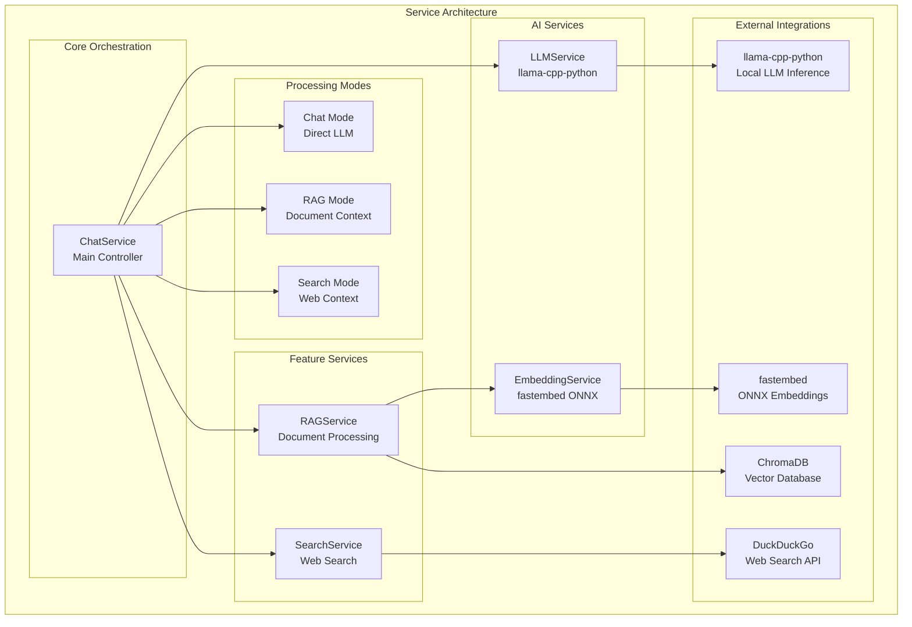

#### Service Descriptions

##### ChatService
- **Purpose**: Main orchestrator that coordinates all other services
- **Modes**: Handles three operation modes (Chat, RAG, Search)
- **Responsibilities**: 
  - Message processing and routing
  - Context injection for RAG/Search modes
  - Conversation management and persistence
  - Streaming response coordination

##### LLMService
- **Purpose**: Wraps llama-cpp-python for local LLM inference
- **Features**: 
  - Model loading and unloading
  - Synchronous and asynchronous generation
  - Streaming token generation with callbacks
  - GPU acceleration support (CUDA/Metal)
- **Configuration**: Context length, GPU layers, sampling parameters

##### EmbeddingService
- **Purpose**: Text embedding generation using ONNX models
- **Technology**: fastembed (avoids CUDA conflicts with llama-cpp-python)
- **Models**: Uses optimized ONNX models like all-MiniLM-L6-v2
- **Benefits**: Fast inference, CPU-optimized, small memory footprint

##### RAGService
- **Purpose**: Document processing and retrieval for Q&A
- **Components**:
  - Document loading (PDF, TXT, MD, DOCX)
  - Text chunking with overlap
  - Vector storage using ChromaDB
  - Similarity search and ranking
- **Features**: Source citation, relevance scoring, document management

##### SearchService
- **Purpose**: Web search integration for real-time information
- **Provider**: DuckDuckGo (no API key required)
- **Features**: Query processing, result ranking, snippet extraction

### 4. Data Flow Architecture

The Hearth AI implements three distinct data processing pipelines, each optimized for different use cases and information sources.

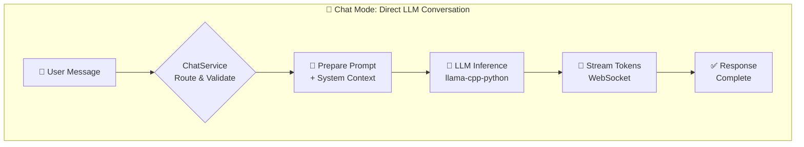

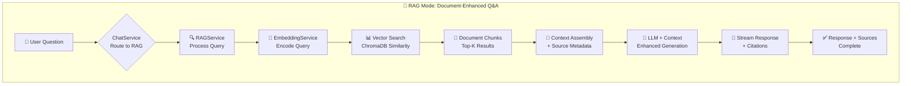

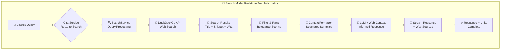

#### Data Flow Explanations

##### 💬 **Chat Mode Flow**
1. **User Input**: Direct message from user interface
2. **Routing**: ChatService validates and routes to direct LLM processing
3. **Prompt Preparation**: System prompt + user message formatting
4. **LLM Inference**: Local model generates response using llama-cpp-python
5. **Streaming**: Tokens streamed in real-time via WebSocket
6. **Completion**: Full response delivered to user

##### 📄 **RAG Mode Flow**
1. **User Question**: Question about uploaded documents
2. **RAG Routing**: ChatService directs to RAG pipeline
3. **Query Embedding**: User question converted to vector representation
4. **Vector Search**: Similarity search against document embeddings in ChromaDB
5. **Chunk Retrieval**: Most relevant document sections retrieved
6. **Context Assembly**: Retrieved chunks formatted with source metadata
7. **Enhanced Generation**: LLM generates response using document context
8. **Cited Response**: Answer includes source citations and references

##### 🌐 **Search Mode Flow**
1. **Search Query**: User's request for current/web information
2. **Search Routing**: ChatService activates web search pipeline
3. **Query Processing**: Search terms optimized for web search
4. **Web Search**: DuckDuckGo API returns relevant web results
5. **Result Processing**: Results filtered, ranked, and summarized
6. **Context Formation**: Web content structured for LLM consumption
7. **Informed Generation**: LLM responds using current web information
8. **Sourced Response**: Answer includes web links and source attribution

#### Key Data Flow Characteristics

| Mode | Latency | Context Source | Response Type | Use Case |
|------|---------|---------------|---------------|----------|
| **Chat** | ~2-5s | System Prompt | Direct Answer | General conversation, coding help |
| **RAG** | ~3-8s | Documents | Cited Answer | Document Q&A, research queries |
| **Search** | ~5-10s | Web Results | Sourced Answer | Current events, real-time info |

### 5. Data Models and Storage

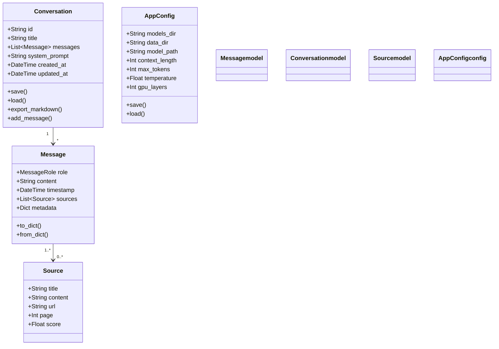

#### Storage Structure

```
data/
├── config.json                 # Application configuration
├── conversations/             
│   ├── {uuid}.json           # Individual conversation files
│   └── metadata.json         # Conversation metadata
├── vectorstore/              # ChromaDB persistence
│   ├── chroma.sqlite3        # Vector database
│   └── indexed_files.json    # Document indexing metadata
└── logs/                     # Application logs (optional)
```

### 6. Configuration Management

The application uses a hierarchical configuration system:

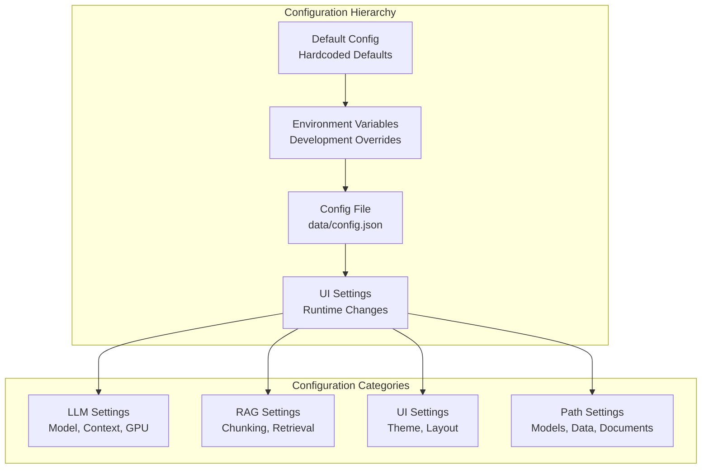

### 7. Deployment Architecture

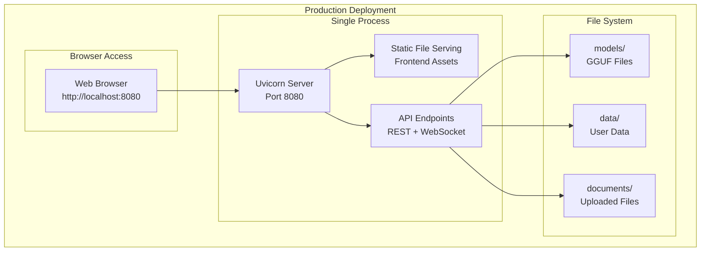

### 8. Technology Stack Details

#### Frontend Stack
- **React 19**: Modern React with concurrent features and Suspense
- **TypeScript**: Type safety and enhanced developer experience
- **Vite**: Fast build tool with HMR for development
- **Tailwind CSS v4**: Utility-first CSS framework
- **Lucide React**: Icon library for consistent UI
- **Native WebSocket API**: For real-time streaming communication

#### Backend Stack
- **FastAPI**: High-performance async web framework
- **Uvicorn**: ASGI server with WebSocket support
- **Pydantic**: Data validation and settings management
- **Python 3.11+**: Modern Python with performance improvements

#### AI/ML Stack
- **llama-cpp-python**: LLM inference with GGUF model support
- **fastembed**: ONNX-based embedding models (CPU optimized)
- **ChromaDB**: Vector database for document embeddings
- **DuckDuckGo Search**: Web search without API keys

#### Document Processing
- **PyPDF**: PDF document parsing
- **python-docx**: Word document processing
- **Built-in parsers**: TXT and Markdown support

### 9. Performance Considerations

#### Memory Management
- **Model Loading**: Lazy loading of services to minimize startup memory
- **GPU Memory**: Configurable GPU layer allocation for VRAM optimization
- **Document Chunking**: Efficient text splitting with overlap management
- **Vector Storage**: ChromaDB with configurable persistence

#### Streaming Performance
- **WebSocket Streaming**: Real-time token streaming for responsive UX
- **Async Processing**: Non-blocking LLM inference with callback handling
- **Background Tasks**: Async document processing and indexing

#### Scalability
- **Single User Design**: Optimized for local desktop usage
- **Resource Limits**: Configurable context length and batch sizes
- **Efficient Storage**: Compressed vector embeddings and conversation serialization

### 10. Security and Privacy

#### Local-First Architecture
- **No External APIs**: All processing happens locally (except optional web search)
- **Data Privacy**: Conversations and documents never leave the local machine
- **Model Privacy**: Local LLM inference without cloud dependencies

#### File Security
- **Sandboxed Upload**: Document uploads restricted to designated directories
- **Input Validation**: All user inputs validated through Pydantic schemas
- **Path Traversal Protection**: Secure file path handling

### 11. Extension and Customization

#### Adding New Document Formats
```python
# In utils/document_loader.py
def _load_new_format(self, file_path: str) -> List[DocumentChunk]:
    # Custom document parsing logic
    pass
```

#### Adding New Chat Modes
```python
# In services/chat_service.py
class ChatMode(Enum):
    CUSTOM = "custom"

# Add mode handling in ChatService._prepare_messages()
```

#### Custom LLM Integration
```python
# In services/llm_service.py
class CustomLLMService(LLMService):
    # Override methods for custom LLM integration
    pass
```

This architecture provides a robust foundation for a local AI chat application with clear separation of concerns, extensible design, and optimal performance for desktop usage.
