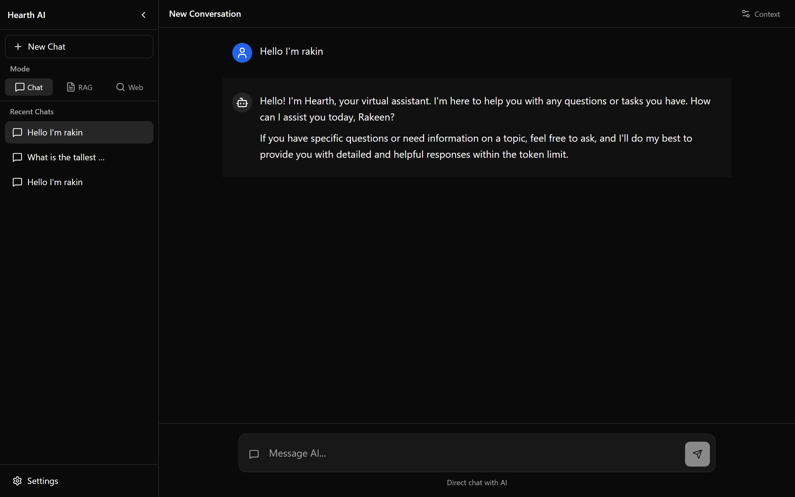

# Hearth AI 🔥

A **private, offline AI assistant** — chat with local LLMs, ask questions over your own documents (RAG),
and search the web with AI-summarized results. No cloud, no API keys, your data stays on your machine.




## Why

I wanted a fully local LLM assistant — useful without internet, private by default, and able to reason
over my own files. Built it end-to-end in Python on top of `llama.cpp`.

### For non-technical users / install and use experience

There are many AI tools on the internet that are arguably better and more feature rich. But all of them
require significant setup, knowledge and trial and error — a hassle, or impossible, for a regular user.
The aim of this app: just install it like any other regular software and start using it.

## Features

- 💬 **Local LLM chat** — runs GGUF models fully offline via `llama-cpp-python`, with streaming responses
- 📄 **Document RAG** — ask questions across your PDF / DOCX / TXT / MD files, with source citations
- 🌐 **AI web search** — DuckDuckGo results, summarized by the local model (optional, when online)
- ⚡ **GPU acceleration** — CUDA (NVIDIA) and Metal (Apple) offload
- 🧩 **Guided setup** — downloads a starter model on first run so you're chatting in minutes
- 💾 **Conversation management** — save, rename, and revisit past chats
- 🌙 **Dark mode** — enabled by default
- 🖥️ **Cross-platform** — Windows, Linux, macOS

## Tech

| Layer | Technology |
|---|---|
| Backend | Python 3.10+ / FastAPI (WebSocket streaming + REST) |
| Frontend | Vite + React 19 + TypeScript |
| Styling | Tailwind CSS v4 |
| LLM | `llama-cpp-python` (llama.cpp), GGUF models |
| Vector store | ChromaDB |
| Embeddings | `fastembed` (ONNX) |
| Web search | DuckDuckGo |
| Documents | PDF, DOCX, TXT, MD |

The UI runs in your browser, but everything — model, embeddings, vector store — stays on your machine.

## Quickstart

Requires **Python 3.10+** and **Node.js 18+**.

```bash
git clone https://github.com/RakinRkz/Hearth-AI
cd Hearth-AI

# 1. Virtual environment
python -m venv venv
source venv/bin/activate        # Windows: venv\Scripts\activate

# 2. Python dependencies
pip install -r requirements.txt

# 3. Build the frontend
cd frontend && npm install && npm run build && cd ..

# 4. Launch
python src/main.py
```

Then open **http://127.0.0.1:8080**. On first run, Hearth AI offers to download a starter model
(Phi-3.5 Mini, ~2.4GB) for you.

> **If step 2 fails with a CMake error**, you have no C++ toolchain — the usual case on a stock
> Windows install, and on any Python version newer than the prebuilt `llama-cpp-python` wheels
> (3.13, for example). Install from the maintainer's wheel index instead:
>
> ```bash
> pip install -r requirements.txt --extra-index-url https://abetlen.github.io/llama-cpp-python/whl/cpu
> ```

### Development mode

For frontend hot reload, run the backend and Vite dev server in two terminals:

```bash
python src/main.py --port 8080     # terminal 1
cd frontend && npm run dev         # terminal 2
```

Open **http://localhost:5173** — Vite proxies API requests to the backend.

## Models

| Model | Size | Best for |
|---|---|---|
| **Phi-3.5 Mini** (default) | ~2.4GB | General chat, coding, reasoning |
| Llama 3.2 3B | ~2.0GB | Everyday tasks, fast responses |
| Qwen2.5 3B | ~2.0GB | Multilingual, coding |
| TinyLlama 1.1B | ~669MB | Low-end hardware, quick tests |

You can also drop any `.gguf` file from [HuggingFace](https://huggingface.co/models?search=gguf) into
`models/` and select it in Settings.

## GPU acceleration

```bash
# NVIDIA (CUDA)
CMAKE_ARGS="-DLLAMA_CUDA=on" pip install llama-cpp-python --force-reinstall --no-cache-dir

# Apple Silicon (Metal)
CMAKE_ARGS="-DLLAMA_METAL=on" pip install llama-cpp-python --force-reinstall --no-cache-dir
```

Then set GPU layers to `-1` in Settings to offload the whole model.

## Usage

- **Chat** — type and press Enter.
- **RAG** — upload documents in the sidebar, then ask questions about them. Answers cite their sources.
- **Web search** — switch to search mode and ask; Hearth AI searches DuckDuckGo and summarizes the results.

## Project structure

```
Hearth-AI/
├── src/
│   ├── main.py          # Entry point (uvicorn)
│   ├── api/             # FastAPI routes, schemas, WebSocket
│   ├── services/        # LLM, RAG, search, chat orchestration
│   ├── models/          # Message and conversation models
│   └── utils/           # Config, document loading, model download
├── frontend/            # React + TypeScript UI
├── models/              # Your .gguf files
├── data/                # Conversations, vector store, config
├── documents/           # Uploaded documents
└── tests/
```

Architecture notes and development instructions live in [`.ai/`](.ai/).

## License

MIT
